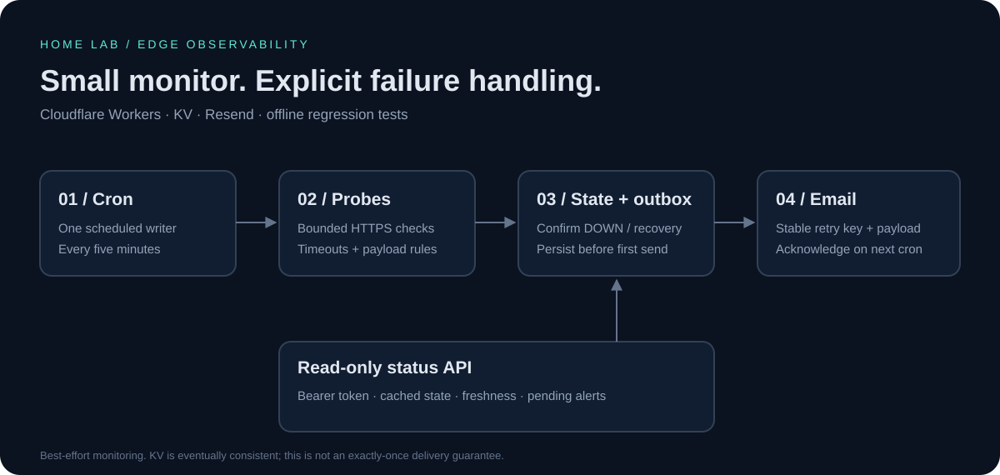
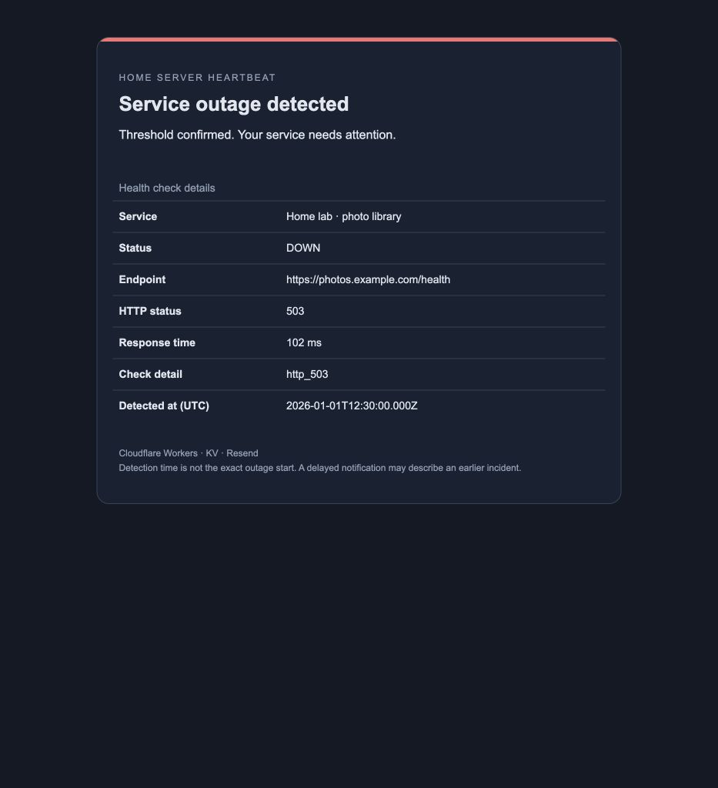

# Home Server Heartbeat

[](https://github.com/RahulSinghParmar/home-server-heartbeat/actions/workflows/check.yml)
[](https://github.com/RahulSinghParmar/home-server-heartbeat/actions/workflows/codeql.yml)

A small Cloudflare Worker that checks self-hosted HTTP services, confirms outages across consecutive checks, and emails incident/recovery notifications through Resend. Built for a home lab: no server to maintain and no alerts on every failed poll.



## What it demonstrates

- **Edge/serverless engineering:** Cron Triggers, Workers KV, bounded concurrent fetches, timeouts, and configuration validation.
- **Stateful reliability:** consecutive-result thresholds, persistent incident state, ordered retryable notifications, and per-service fault isolation.
- **Practical security:** read-only HTTP endpoints, bearer-protected status, no secret-bearing logs, escaped HTML, and plain-text email alternatives.
- **Maintainability:** offline regression tests, pinned tooling/lockfile, formatting checks, Node 22/24 CI, CodeQL, and Dependabot.

This is an external HTTP health monitor, not an agent that receives push heartbeats or measures CPU, disks, backups, or exact uptime. Production deployment and email delivery require your own validation. See [release notes](CHANGELOG.md).

## Default services

| Service          | Probe                                            | Healthy response                                         |
| ---------------- | ------------------------------------------------ | -------------------------------------------------------- |
| Immich photos    | `/api/server-info/ping` on `photos.parmar.homes` | 2xx and JSON `res: "pong"`                               |
| Nextcloud drive  | `/status.php` on `drive.parmar.homes`            | 2xx, installed, not in maintenance, no DB upgrade needed |
| Vaultwarden      | `/alive` on `pass.parmar.homes`                  | 2xx                                                      |
| Glance dashboard | `/` on `dash.parmar.homes`                       | 2xx                                                      |

Existing service names, addresses, production KV binding, five-minute cron, and thresholds are retained. **Verify your installed Immich API path before deploying**; newer versions may use `/api/server/ping`. Redirects now fail instead of following a login page and declaring it healthy. Generic HTTP checks still cannot distinguish every possible HTTP-200 error page.

## Quick start

Requires Node.js 22+, npm, a Cloudflare account with Workers KV, and a Resend account with a verified sender domain for email delivery.

```sh
git clone https://github.com/RahulSinghParmar/home-server-heartbeat.git
cd home-server-heartbeat
npm ci
npm test
npm run check
npm run build
```

Tests mock every outbound request; the build is a **dry run**, not a deployment. There are no runtime npm dependencies. Before using real services or deploying, follow the [operations and migration checklist](docs/OPERATIONS.md).

To inspect the actual email template with synthetic data, run `npm run preview`, then open `http://127.0.0.1:8789` for an outage or `/recovery` for a recovery. It sends no email and uses no credentials.



_Synthetic browser preview of the actual email HTML, not a real incident or an inbox-deliverability test. Email clients may render it differently._

## Configuration

Keep secrets in Cloudflare secrets, ordinary variables in the dashboard or your reviewed Wrangler configuration, and local values in ignored `.dev.vars`. See [.dev.vars.example](.dev.vars.example). Defaults retain the maintainer's existing setup; forks must supply their own addresses, endpoints, and KV namespace.

| Setting              | Default                             | Purpose                                                              |
| -------------------- | ----------------------------------- | -------------------------------------------------------------------- |
| `HEARTBEAT_KV`       | Existing binding in `wrangler.json` | Required persistent state/outbox                                     |
| `RESEND_API_KEY`     | None                                | Secret for email; missing secret retains queued alerts               |
| `MONITOR_TOKEN`      | None                                | Random secret, 32+ characters, enables authenticated `/status`       |
| `NOTIFY_EMAIL`       | Existing maintainer recipient       | One bare recipient address                                           |
| `FROM_EMAIL`         | `alerts@parmar.homes`               | One verified bare sender address                                     |
| `FAILURE_THRESHOLD`  | `3`                                 | Consecutive failures to confirm DOWN; range 1–100                    |
| `SUCCESS_THRESHOLD`  | `2`                                 | Consecutive successes after DOWN to confirm recovery; range 1–100    |
| `REQUEST_TIMEOUT_MS` | `10000`                             | Probe timeout; range 250–30000                                       |
| `STALE_AFTER_MS`     | `900000`                            | Mark observations older than 15 minutes stale; range 300000–86400000 |
| `SERVICES_JSON`      | Four services above                 | JSON array replacing the entire service list; 1–20 entries           |

Example replacement service list:

```json
[
  {
    "name": "Photo library",
    "url": "https://photos.example.com/api/server/ping",
    "check": "immich"
  },
  {
    "name": "Dashboard",
    "url": "https://dashboard.example.com/health",
    "check": "http"
  }
]
```

Check types are `http` (default), `immich`, and `nextcloud`. URLs must use HTTPS, without embedded credentials or fragments. Do not put tokens in URLs: endpoint addresses appear in alert emails. Names must produce unique state keys and stay stable across deployments.

## API and alert behavior

`GET /` and `GET /health` return only Worker liveness. `GET /status` requires an `Authorization: Bearer <MONITOR_TOKEN>` header and returns **cached** per-service state, last check/result, freshness, consecutive counters, and pending notification counts. It returns 503 for UNKNOWN/DOWN/stale observations or pending alerts; 200 means all configured services have fresh UP state and no pending alerts. No HTTP route triggers checks, changes counters, or sends notifications.

Every five minutes, cron runs up to four service tasks concurrently. Three consecutive failures confirm an outage; two successes after an outage confirm recovery. New alerts are persisted before delivery and retried with a fixed Resend idempotency key and payload. Delivery acknowledgement is persisted on the next cron to respect KV's per-key write limit. An unchanged outage produces no new incident event. See [delivery semantics and failure recovery](docs/OPERATIONS.md#state-and-delivery-semantics).

## Important operational limits

- **Not guaranteed free:** the default four-service/five-minute schedule uses approximately 1,152 KV writes/day. This exceeds the currently documented [free allowance of 1,000/day](https://developers.cloudflare.com/kv/platform/limits/). Review your plan or trade cadence for lower usage before deployment.
- **Not exactly-once delivery:** [KV is eventually consistent](https://developers.cloudflare.com/kv/api/write-key-value-pairs/). Run one production cron writer. Resend retries are bounded to a safe window; expired alerts remain visible for operator review rather than being silently dropped or blindly resent.
- **Not an independent watchdog:** `/health` does not prove cron is running. An independent checker should alert on stale authenticated `/status` observations.
- **Deployment is deliberate:** CI tests and bundles only. Existing Cloudflare Workers Builds configuration, if any, is managed separately in your account; verify it before merging deployment-sensitive changes.

## Repository map

```text
src/config.js           Service defaults and validated environment settings
src/index.js            Worker routes, probes, state machine, persistent outbox
src/notification.js     Escaped HTML and plain-text email payloads
test/monitor.test.js    Offline regression tests; no real service/email requests
scripts/preview.mjs     Local synthetic email preview
docs/OPERATIONS.md      Deployment, migration, quota, incidents, rollback
wrangler.json           Existing Worker/KV/cron configuration
```

Read [CONTRIBUTING.md](CONTRIBUTING.md) for development and [SECURITY.md](SECURITY.md) for the threat model and private reporting. An open-source license has not yet been selected; public source visibility alone does not grant an open-source license.
